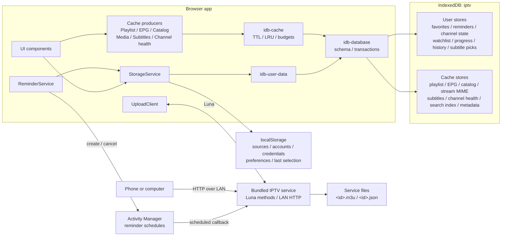

# Storage and Data Management

The app keeps your setup and viewing state on the TV so it can reopen quickly
and remember where you left off. It separates important user data from
downloaded data that can be recreated.

## What is stored

| Data | Examples | Where it is kept | Removed by Clear Cache? |
| --- | --- | --- | --- |
| Setup and preferences | Playlist and EPG sources, Xtream account details, theme, language, text size, time zone, active account and channel | Small app-private browser storage | No |
| Personal data | Favorites, reminders, channel order and names, hidden channels, Watchlist, Recently Watched, playback progress, audio and subtitle choices | App-private database on the TV | No |
| Downloaded cache | Parsed playlists, program guides, movie and series catalogs, media metadata, downloaded subtitles, channel health results | App-private database on the TV | Yes |
| LAN-uploaded playlists | Original M3U files uploaded from another device | Private storage owned by the bundled upload service | No |

## Implementation architecture

The persistence layer has four modules with deliberately separate
responsibilities:



- `src/services/storage-service.ts` is the application-facing facade. It keeps
  user data in memory so existing getters remain synchronous.
- `src/services/idb-user-data.ts` owns durable, non-evictable user records and
  serializes their writes.
- `src/services/idb-cache.ts` owns disposable records, byte accounting,
  expiration, LRU access times, budgeting, and eviction.
- `src/services/idb-database.ts` owns the shared IndexedDB schema, connection,
  requests, and transaction completion.
- `bundled-service/src/lan/` runs in the separate Node service because the
  webOS browser sandbox cannot listen on the LAN. `setup/` owns phone setup;
  `upload/` owns persisted M3U files.

### localStorage

Small boot-critical values retain the `iptv_` prefix. `StorageService` values
use JSON encoding; the logger's standalone `iptv_log_level` key is a raw string.
This is the complete active key inventory:

| Key | Type | Stored content | Classification |
| --- | --- | --- | --- |
| `iptv_playlists` | `PlaylistEntry[]` | Stable id, display name, source URL/type, uploaded channel count, and Xtream username, password, and live-output preference | Configuration |
| `iptv_epg_url` | `string` | Manually configured XMLTV URL | Configuration |
| `iptv_last_channel` | `{ index, key?, stream?, exact? }` | Last played channel: its array index, stable channel key, stream hash (URL with rotating tokens dropped, plus headers and DRM options), and exact hash (URL as written). Autoplay resolves exact, then stream, then key, then index | Navigation state |
| `iptv_selectedXtream` | `string \| null` | Account id used by Movies, Series, and Search | Navigation state |
| `iptv_show_hidden_channels` | `boolean` | Whether normal lists reveal hidden channels in a dimmed state | Preference |
| `iptv_auto_play` | `boolean` | Whether startup automatically plays the selected channel | Preference |
| `iptv_live_reconnect_attempts` | `number` | Live channel reconnection limit (0–5; default 3) | Preference |
| `iptv_playlist_refresh_interval_hours` | `number` | Channel-list refresh interval: 0 (off), 1, 3, 6, 12, or 24 hours; default 6 | Preference |
| `iptv_epg_refresh_interval_hours` | `number` | Program-guide refresh interval: 0 (off), 1, 3, 6, 12, or 24 hours; default 6 | Preference |
| `iptv_xtream_catalog_refresh_interval_hours` | `number` | Xtream Movies, Series, and Search catalog interval: 1, 3, 6, 12, or 24 hours; default 6 | Preference |
| `iptv_locale` | `string` | Explicit interface locale or `system` | Preference |
| `iptv_theme` | `string` | Selected application theme id | Preference |
| `iptv_text_size` | `string` | Selected text-scale id | Preference |
| `iptv_animation_mode` | `essential \| reduced \| full` | Animation profile; defaults to immediate navigation scrolling, while Essential disables costly motion for older TVs | Preference |
| `iptv_overlay_style` | `dark \| frosted` | Player OSD/sidebar/menu glass style | Preference |
| `iptv_tz_mode` | `device \| feed` | Which time zone displays EPG times | Preference |
| `iptv_epg_tz_offset` | `number \| null` | Last known feed offset in minutes east of UTC | Small derived state |
| `iptv_epg_offsets` | `Record<string, number>` | User time correction in minutes, keyed by EPG source URL | Preference |
| `iptv_online_subtitles` | `OnlineSubtitleConfig` | Preferred language; SubDL and Assrt API keys; OpenSubtitles API key, username, password, access token, and token timestamp | Configuration and credentials |
| `iptv_log_level` | `string` | Optional runtime logger threshold used by diagnostics | Developer preference |

This lets the app discover its sources and render basic preferences before
opening IndexedDB. No fixed Web Storage capacity is assumed: it is intentionally
limited to small values because the effective webOS limit is implementation
dependent and much smaller than the origin quota available to IndexedDB.

If a localStorage write reports quota exhaustion, `StorageService` evicts
derived playlist and stream-MIME data and retries once. A second failure is
reported as `persistence.local.write.failed`; it is not silently treated as a
successful save.

### IndexedDB schema

The database is named `iptv`. webOS already isolates IndexedDB by application
origin, so object-store names do not repeat the `iptv_` prefix.

#### User-data stores

| Object store | Key examples | Additional indexes | Contents |
| --- | --- | --- | --- |
| `favorites` | `favorite:<channel-key>` | None | Stable channel keys |
| `reminders` | `reminder:<channel-key>\|<start-ms>` | None | Channel key/name, EPG source URL, program title, start/stop milliseconds, answered flag; `updatedAt` is the start time |
| `channel-state` | `custom:meta` | None | Customization version, channel/group order, and user-created group keys |
| `channel-state` | `custom:channel:<channel-key>` | None | Optional renamed display name, destination group, and hidden flag |
| `channel-state` | `custom:group:<group-key>` | None | Optional renamed group name and hidden flag |
| `channel-state` | `audio:<channel-key>` | None | Preferred audio rendition name and language |
| `channel-state` | `subtitle:<channel-key>` | None | Explicit off state or preferred subtitle name/language/CC mode |
| `channel-state` | `offset:<channel-key>` | None | Subtitle timing adjustment in seconds |
| `watchlist` | `watch:<account-id>\|<vod-or-series>\|<item-id>` | `scope` | Name, poster, rating, category, extension, and added time; scope is account and content kind |
| `playback-progress` | `resume:<account-id>\|<vod-or-episode>\|<item-id>` | `expiresAt`, `updatedAt` | Position, duration, title/poster/extension snapshot, optional autoplay queue and Watchlist owner |
| `playback-progress` | `catchup:<channel-key>\|<program-start>` | `expiresAt`, `updatedAt` | EPG source URL, program start/stop, title/description/icon snapshot, position, completion, update time, and computed expiry |
| `recently-watched` | `live:<channel-key>` | `updatedAt` | Channel key and last-confirmed watch time; capped to 30 live entries |
| `online-sub-picks` | `pick:<account-id>\|<vod-or-episode>\|<item-id>` | None | Provider id, provider result id, display name, language, and subtitle format |

Every user store uses `key` as its key path. The common record shape is:

```ts
interface UserDataRecord<T> {
  key: string;
  value: T;
  scope?: string;
  updatedAt?: number;
  expiresAt?: number;
}
```

These stores are not included in cache accounting and are never passed to the
eviction algorithm.

#### Cache stores

| Object store | Key path | Indexes | Contents |
| --- | --- | --- | --- |
| `playlist-cache` | `key` | `expiresAt`, `lastAccessedAt` | Key `combined`: payload version, playlist-source signature, derived EPG sources, timestamp, and chunk and channel counts. The parsed `Channel[]` (playback URLs/headers/catch-up metadata included) sits in chunk records `<key>#000000`, … with the same timestamp, a small first chunk and larger ones after, so a launch shows the first channels while the rest are read; eviction and clearing remove the chunks with the head, which alone holds the entry's accounting. |
| `epg-cache` | `url` | `expiresAt`, `lastAccessedAt` | Parsed XMLTV channels, aliases/icons, program start/stop/title/description/category/icon, feed offset, optional channel filter, and timestamp |
| `catalog-cache` | `key` | `expiresAt`, `lastAccessedAt` | Xtream categories, VOD/series lists and details, and media-container probes |
| `stream-mime-cache` | `key` | `expiresAt`, `lastAccessedAt` | Normalized provider route mapped to detected MIME and probe time; accounted and evicted in the `catalog` category |
| `subtitle-cache` | `key` | `expiresAt`, `lastAccessedAt` | Provider/result key and downloaded SRT, WebVTT, ASS, or SSA text |
| `channel-health-cache` | `key` | `expiresAt`, `lastAccessedAt` | Per-channel healthy, suspect, or unavailable status from the latest stream check |
| `search-index-cache` | `key` | `expiresAt`, `lastAccessedAt` | Folded Search text of one playlist, guide, or catalog cache record, keyed by source store, source key, source timestamp, and index format; one string plus `Uint32Array` offsets. Written by the app worker after the page reserves room; clearing a source store removes its indexes |
| `cache-meta` | `category` | None | `{bytes, entries, updatedAt}` for `playlist`, `epg`, `catalog`, `subtitle`, `health`, `search`, and `total` |

Known `catalog-cache` key families are:

```text
<account-id>|vod_categories
<account-id>|vod_streams|<category-id>
<account-id>|vod_all
<account-id>|vod_info|<vod-id>
<account-id>|series_categories
<account-id>|series|<category-id>
<account-id>|series_all
<account-id>|series_info|<series-id>
<account-id>|media_probe|<vod-or-episode>|<item-id>
```

Catalog list/detail payloads contain the provider's normalized names, ids,
posters, ratings, categories, stream extensions, plots, cast, genres, release
data, episode metadata, and sidecar-subtitle descriptors. Media probes contain
the parsed container information used by the OSD, such as codec, resolution,
frame rate, HDR, and audio-channel metadata.

Cache payloads are normalized to a shared envelope:

```ts
interface CacheFields {
  cacheCategory: 'playlist' | 'epg' | 'catalog' | 'subtitle' | 'health';
  createdAt: number;
  updatedAt: number;
  lastAccessedAt: number;
  expiresAt: number | null;
  byteSize: number;
}
```

`byteSize` is the UTF-8 size of the serialized JSON record when `TextEncoder`
is available; the fallback path uses two bytes per JavaScript character. It is
an accounting estimate, not IndexedDB's internal on-disk allocation.

Record mutations and their `cache-meta` changes commit in the same IndexedDB
transaction. Cache mutations also pass through one promise chain so two
concurrent updates cannot apply byte deltas to stale metadata. If metadata is
missing or predates this envelope, the app scans all cache stores and rebuilds
it.

The combined playlist uses the fixed key `combined`, payload version 2, and an
FNV-1a signature of the configured playlist JSON. A source edit therefore
invalidates a structurally valid but now unrelated parsed playlist.

### Cache freshness

| Category | Refresh setting | Read behavior |
| --- | --- | --- |
| Playlist | Off, 1, 3, 6, 12, or 24 hours; default 6 | Requires matching payload version, source signature, and non-empty channels. Startup uses a matching cache at any age; the current setting is compared with the stored timestamp to schedule the next refresh, which runs at once in the background when the cache is overdue. Off keeps a matching cache until its source configuration changes or the user refreshes all data |
| Program guide | Off, 1, 3, 6, 12, or 24 hours; default 6 | Each source retains its own timestamp. Off stops periodic refresh and ignores age, but a missing or structurally invalid source is still downloaded once so a cold cache can populate |
| Xtream catalog | 1, 3, 6, 12, or 24 hours; default 6 | Callers compare each entry's timestamp with the current setting. An expired list (categories, category items, or the whole Search catalog) is returned at once and re-fetched in the background for the next open; an expired detail is re-fetched before it is shown. There is no Off option, so Movies, Series, and Search cannot remain permanently stale |
| Media probe | No expiry | Stored in the catalog category and still subject to LRU/budget cleanup |
| Stream MIME probe | 7 days | Expired reads become misses; records participate in catalog LRU and accounting |
| Downloaded subtitle | 30 days | An expired read becomes a miss and deletes the record |
| Channel health result | 30 days | Expired results are discarded; a new health check replaces results for checked channels |
| Search index | 7 days | Used only while its source record's key, timestamp, and the index format still match; otherwise rebuilt from the source record. Built ahead of Search while the UI is idle after startup and after each playlist, guide, catalog, or account change |

Reads update `lastAccessedAt` in a best-effort follow-up transaction. Failure to
write this bookkeeping does not turn a valid cache hit into a miss.

### Refresh scheduling

The three settings are under **Settings → Advanced**. `CONFIG` provides their
defaults; runtime freshness uses the saved preferences and the age of the
loaded data. Off stops periodic channel-list or program-guide refresh, while
still allowing a missing guide cache to populate. Only a cold cache blocks
startup on a channel-list download; an overdue one is shown first and refreshed
in the background. Xtream catalogs refresh when Movies, Series, or Search
accesses expired data and do not have an Off option. Background catalog
refreshes are shared per cache key, run at most two at a time with the rest
queued, survive leaving the view, keep the stale copy on a failed or empty
response, and are discarded if the catalog cache is cleared while they are
queued or in flight. A channel-list refresh records the source configuration
and cache state it started with; if either changes before it finishes, its
result is not written to the cache.

An incomplete automatic channel-list refresh keeps the previous complete list
instead of publishing partial data. **Refresh All Data** remains available in
Off mode; it reloads enabled channel sources, forces the configured guide
sources to refresh, and clears Xtream catalog and related media-metadata caches.

The app does not provide account-based cloud sync or a remote backup of this
data. Playlist providers and subtitle services still receive the requests
needed to download their content.

Xtream credentials and source URLs are stored in the app's private webOS
storage. They are isolated from other normal TV apps, but the app does not add
its own encryption layer.

## Why the app uses a cache

Program guides and catalogs can be much larger than settings or favorites.
Keeping their processed versions on the TV makes startup, guide reopening, and
catalog browsing faster and reduces repeated provider downloads.

Cached data is disposable. If it expires, is cleared, or is automatically
removed to recover space, the app downloads or rebuilds it when needed. Personal
data is stored separately and is never selected for cache cleanup.

Channel logos are not copied into this managed cache. They use the TV browser's
normal image cache, so the cache total in Settings does not include them.

## Cache size and the displayed budget

Open **Settings -> Data Management** to see the managed cache total and its
breakdown:

- Playlists
- Program guide
- Catalog and media metadata
- Subtitles
- Channel health results
- Search index

The second number is a **soft cache budget**, not reserved or currently used
space. For example, `1.8 MiB / 75 MiB` means the managed cache currently uses
about 1.8 MiB and may grow toward a 75 MiB target.

The budget follows the per-app quota webOS grants, which depends on the free
space left on the TV, so it differs between TV models and over time. How the
app reads that quota depends on the engine:

| Engine | Quota source | `share` |
| --- | --- | --- |
| Chromium 61+ (webOS 5 and later) | `navigator.storage.estimate()` | 0.5 |
| Chromium 53 (webOS 4) | `navigator.webkitTemporaryStorage.queryUsageAndQuota()` | 0.25 |

```text
budget = min(floor(reportedQuota * share), 1 GiB)
```

For example, on webOS 5 and later a quota of about 150 MiB gives a budget of
75 MiB.

On webOS 4 the quota is only a few MiB, and writes start failing well before
it is reached. The API also reports no usage, so the app cannot tell how full
storage is before a write, and personal records share the same quota. The
cache therefore keeps to a quarter of the quota. A parsed playlist larger
than the budget stretches it to the playlist's size, leaving no room for other
cached data.

If no quota is reported, or the query gets no answer within a second, there
is no budget: Settings shows it as `—`, and cleanup and Search index storage
wait for webOS to reject a write. If the quota query answers after its
one-second wait, the app uses that answer from then on.

The displayed total covers only the managed cache. Small settings, personal
records, browser-managed image files, and original LAN-uploaded M3U files are
not included.

## Automatic cleanup

The app checks the cache before and after writes. Cleanup begins when the cache
would exceed a budget grounded in a reported quota, or when overall app storage
approaches 80% of that quota. A record larger than the whole budget is stored
without clearing the rest, since evicting everything else still would not make
it fit.

Cleanup removes data in this order:

1. Expired entries.
2. Least-recently-used Search indexes.
3. Least-recently-used subtitles.
4. Least-recently-used catalog and media metadata.
5. Least-recently-used program guides.
6. Least-recently-used parsed playlists, only after webOS rejects a write.

A Search index never causes other data to be removed: it replaces older
indexes of the same source and is skipped when it would take more than 10% of
the room left in the budget. A failed index write is dropped without a retry.

This order favors quick startup and live TV while discarding content that is
usually cheap to download again. Cleanup ahead of a write stops before the
parsed playlist the app starts from. If webOS still rejects a write because
storage is full, the app performs another cleanup, the playlist included, and
retries once.

More precisely, an incoming write computes:

```text
cacheOver  = currentManagedCache + incomingDelta - softBudget
originOver = reportedOriginUsage + incomingDelta - 80% of reportedQuota
required   = max(cacheOver, originOver)
```

`cacheOver` counts only when webOS reported a quota and the incoming delta fits
the budget on its own, and `originOver` only when it also reported usage. When
`required` is positive, cleanup removes at least that amount plus the
larger of a margin and 10% of the incoming delta. The margin is 4 MiB, or 10%
of the budget when that is smaller. The margin avoids running another
scan immediately after the next small write. A native `QuotaExceededError`
triggers a second path that prunes the incoming record size plus 4 MiB, then
retries the write once.

The category order is implemented after a global expired-record pass. Within
each category, candidates sort by ascending `lastAccessedAt`, giving LRU
behavior among the records known to the cache manager.

## Clear Cache and Reset App

### Clear Cache

**Clear Cache** removes downloaded and processed data, including cached channel
health results. It keeps:

- Accounts and source settings
- App preferences
- Favorites and reminders
- Channel customization
- Watchlist and Recently Watched
- Playback progress
- Audio and subtitle choices
- Original LAN-uploaded M3U files

The next use of a cleared area may be slower while its data is downloaded and
processed again.

### Reset App

**Reset App** permanently removes the app's local setup, personal data, and
managed cache, then restarts at initial setup.

Original LAN-uploaded M3U files belong to the separate LAN service and are
not part of the browser database or cache meter. They should be removed through
the playlist/upload workflow if they must also be deleted; otherwise the app
may discover them again after a reset.

## Storage outside the browser origin

### Bundled-service upload files

The upload store chooses the first writable directory in this order:

```text
WEBOS_UPLOAD_DIR environment override
/media/internal/iptv-uploads
<service-install-directory>/uploads
/tmp/iptv-uploads
```

The first two usable locations are intended to survive reboot. `/tmp` is only a
last-resort fallback and is not persistent across reboot.

Each upload creates two files:

| File | Stored content |
| --- | --- |
| `<id>.m3u` | Original validated M3U text |
| `<id>.json` | `{id, name, count, createdAt}` metadata |

The HTTP `DELETE /uploads/<id>` route deletes both files. The browser-side
`iptv_playlists` entry for an uploaded source is a synchronized reference to
these service-owned files, not another copy of the M3U.

### webOS Activity Manager

Every pending reminder also creates a persistent OS activity named:

```text
iptvReminder-<channel-key>-<start-ms>
```

The activity stores its local scheduled time and callback. In Developer Mode
the callback targets the bundled service and carries the truncated title,
channel name/key, application id, and localized alert labels. In retail mode it
targets `createToast` with the application id and localized message. These OS
activities duplicate only the scheduling information needed to wake at the
correct time; the authoritative reminder record remains in IndexedDB.

Removing or pruning a reminder sends Activity Manager a best-effort cancel by
activity name. Startup reschedules every still-pending reminder with
`replace: true`, repairing missing OS activities without creating duplicates.
Changing an EPG source's time correction migrates reminder and catch-up keys to
the corrected program time. The old reminder activity is canceled and replaced.

### Browser-managed HTTP cache

Channel logos and normal fetched resources may enter Chromium's HTTP cache.
The app does not enumerate or account for those files, and Clear Cache only
clears the app-managed IndexedDB cache. The application does not currently use
the Cache Storage API, `sessionStorage`, or cookies for its own persistence.

## Write ordering and recovery

Changes appear immediately in the interface and are queued for durable storage.
Each logical update diffs the previous and next record sets into `put` and
`delete` operations, then commits them in one transaction for that store.
`idb-user-data` serializes all writes through `writeChain`, preserving call
order even when a prior operation rejects. The first asynchronous failure is
latched for the next flush.

The app flushes pending writes when it moves to the background and before an
explicit exit. A failed flush triggers one recovery attempt:

1. Serialize the complete current in-memory user-data snapshot.
2. Replace all seven user-data stores in one transaction.
3. Wait for the write chain again.

If recovery succeeds, the flush emits a recovered event. If it still fails, an
explicit exit is canceled, the app remains open, and a save-failure toast is
shown instead of silently losing the latest changes.

When IndexedDB cannot open, initialization logs the failure. Destructive
operations such as Clear Cache and Reset App do not report success when
IndexedDB is unavailable.

### Reset transaction order

Reset is intentionally ordered so local configuration is not erased before a
database failure can be reported:

1. Clear all derived cache stores and `cache-meta`.
2. Clear all user-data stores and internal metadata.
3. Clear localStorage.
4. Emit the completion event.
5. Reload the app.

If either database clear fails, Settings shows an error and leaves the
remaining local configuration intact.

## Diagnostics

Persistence logs use stable component tags:

| Tag | Responsibility |
| --- | --- |
| `PersistenceDB` | Open, blocked open, and schema upgrade |
| `CacheStorage` | Cache reads, writes, accounting, quota, eviction, and clear |
| `UserDataStorage` | User-record writes, recovery, and clear |
| `StorageService` | localStorage quota handling and facade initialization |
| `App` | Background/exit flush and whole-app reset |

Important records include machine-readable `event=` fields such as
`persistence.cache.budget.exceeded`, `persistence.user.flush.recovered`, and
`persistence.reset.completed`. `scripts/tv.sh diag` uses these events to report
quota, write, flush, and reset failures without parsing prose.

`src/services/persistence-diagnostics.test.ts` statically enforces that every
info, warning, and error emitted by the persistence modules carries an event
identifier.

Because there is no cloud backup, **Reset App**, uninstalling the app, or
clearing its webOS application data can permanently remove local user data.
